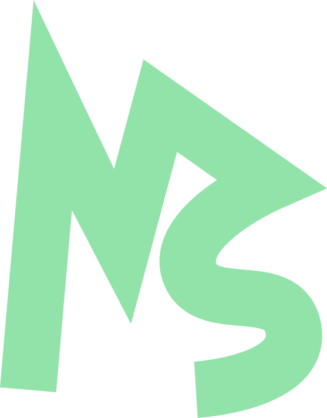

<div align="center">



# Makeshift Blog

**The public website for Makeshift Engineering.**

[](https://github.com/makeshift-engineering/makeshift-blog/actions/workflows/build.yml)
[](https://github.com/makeshift-engineering/makeshift-blog/actions/workflows/lint.yml)

</div>

## Technology

- [Next.js](https://nextjs.org/) App Router
- [React](https://react.dev/)
- [TypeScript](https://www.typescriptlang.org/)
- CSS Modules and global CSS design tokens
- [Bun](https://bun.sh/) for dependency management and scripts

The site uses `next/font` for its typography, static metadata for search and social sharing, and `public/logo.svg` as the site favicon and brand mark.

## Project structure

```text
makeshift/
├── .github/
│   └── workflows/
│       └── lint.yml              # CI format and lint checks
├── app/
│   ├── components/               # Shared page components
│   │   ├── Footer/
│   │   ├── HeroTerminal/
│   │   ├── Navbar/
│   │   └── ScrollReveal.tsx
│   ├── globals.css               # Global styles and design tokens
│   ├── layout.tsx                # Root layout and site metadata
│   ├── page.tsx                  # Homepage
│   └── page.module.css           # Homepage styles
├── public/
│   └── logo.svg                  # Brand mark and favicon source
├── eslint.config.mjs             # ESLint flat configuration
├── next.config.mjs               # Next.js configuration
├── package.json                  # Scripts and dependencies
├── tsconfig.json                 # TypeScript configuration
└── bun.lock                     # Locked Bun dependency versions
```

## Development

### Prerequisites

Install [Bun](https://bun.sh/docs/installation). The project uses the Bun lockfile, so Bun should be used for installation and scripts.

### Installation

```bash
git clone https://github.com/makeshift-engineering/makeshift.git
cd makeshift
bun install --frozen-lockfile
```

### Run locally

Start the development server:

```bash
bun run dev
```

Open [http://localhost:3000](http://localhost:3000) in your browser. Changes to files under `app/` are reflected automatically.

## Production

Create an optimised production build:

```bash
bun run build
```

Serve the generated build locally:

```bash
bun run start
```

The application is a standard Next.js deployment and can be deployed to a platform with Next.js support, such as [Vercel](https://vercel.com/). Configure the deployment from the repository’s hosting provider and use `bun run build` as the build command.

## Contributing

This repository contains the Makeshift Engineering website. If you find a problem or have an idea for improvement, open an issue or pull request in [makeshift-engineering/makeshift](https://github.com/makeshift-engineering/makeshift).

Please keep changes focused, preserve the existing visual language, and run all quality checks before submitting a pull request.

## Related links

- [Makeshift Engineering](https://makeshift.pro)
- [GitHub organisation](https://github.com/makeshift-engineering)
- [Engineering blog](https://blog.makeshift.pro)
- [Makeshift Blog repository](https://github.com/makeshift-engineering/makeshift-blog)
- [PenguinDB](https://penguindb.makeshift.pro)
